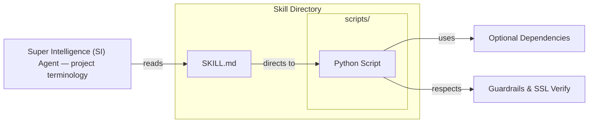

# AGENTS.md

<!-- agent-contract:start -->
## Agent contract

Tool-neutral rules for any AI agent or human working in this repository. This block is maintained by the fleet standard; edit outside the markers.

- **Owner boundary:** this repository owns skill content and the connector scaffold (spec prefix `US-`). Feature routing across repositories: [ecosystem boundaries](https://github.com/Knuckles-Team/pipelines/blob/main/reference/ecosystem-boundaries.md).
- **Setup:** run `scripts/bootstrap.sh`. It is idempotent and non-interactive: it pins uv and Python, syncs the locked environment, installs the git hooks and prints the gate command.
- **Gates:** `uvx pre-commit run --all-files` must pass before you push. Do not bypass hooks to get green.
- **Commits:** one logical change per commit with a `Spec: <ID>` trailer (or `Spec: none (<reason>)`), plus a `Co-Authored-By:` trailer naming the assisting agent. Stage explicit paths only; never `git add -A` or `git add .`. Use your own configured Git identity, never a tool or bot name.
- **Org rules:** [organization AGENTS.md](https://github.com/Knuckles-Team/.github/blob/main/AGENTS.md).
<!-- agent-contract:end -->

## Spec-driven development

Every feature starts with a spec, in this order. Read `.specify/memory/constitution.md` first; it inherits the [organization constitution](https://github.com/Knuckles-Team/pipelines/blob/main/.specify/memory/constitution.md). Route the feature with the [ecosystem boundaries](https://github.com/Knuckles-Team/pipelines/blob/main/reference/ecosystem-boundaries.md) and file each part in its owner's `specs/`. Run the flow with the skills in the table (universal-skills). Rules: [spec standard](https://github.com/Knuckles-Team/pipelines/blob/main/reference/spec-standard.md); templates: pipelines `specs/_template/`.

| Step | Skill | Writes | Checked by |
|---|---|---|---|
| Constitution | `spec-generator` | `.specify/memory/constitution.md` | spec-standard constitution check |
| Specify | `spec-intake-wizard`, `spec-generator` | `specs/<id>/spec.md`, `requirements.md` | spec-standard |
| Clarify | `spec-generator` | resolves each `[NEEDS CLARIFICATION: ...]` marker | spec-standard clarification check |
| Plan | `spec-generator` | `plan.md` (upstream sections, Build contract, Production caller chain, Cross-repo seams) | spec-standard plan check |
| Tasks | `task-planner` | `tasks.md`: `- [ ] T001 [P] [US1] <ROW-ID> ...` | spec-standard task-line check |
| Analyze | `spec-verifier` | `checklists/requirements.md`, gap fixes | spec-standard analysis and checklist |
| Implement | `feature-development-pipeline` | code and bound tests (`mark.spec("ID")` or `// spec: ID`) | `pipelines-hook spec-trailers` |
| Land | repository development skill | commit with `Spec: <IDs>` directly above `Co-Authored-By` | `spec-status` computes SPECIFIED, LANDED, VERIFIED, RETIRED |
| Release | repository development skill | pipelines `releases/*.yml` bundles (PIPE-RELEASE-R020 to R024) | `release-standard` |

Never write code for a row that is not SPECIFIED in this repository's `specs/`. If no row owns the behavior, extend the owning spec first. Never write `status.json` or a `Status:` line; the state is computed.

## ⭐ The Atomicity Edict — every skill is atomic; a skill-workflow is only a grouping (READ FIRST)

This is the governing rule of this repository. Every other convention below is an
application of it.

- **Every skill is ATOMIC.** A skill has exactly **one purpose, one trigger surface,
  one primary capability**. Its `SKILL.md` body describes that single capability and
  nothing more. An atomic skill **must not** contain a multi-step orchestration — no
  numbered `### Step N:` sequence, no `depends_on`, no "first do A, then B, then C"
  pipeline. If a capability needs ordered/parallel stages, it is **not a skill — it is
  a skill-workflow.**

- **A skill-workflow is PURELY the grouping of atomic skills.** It lives in
  `universal_skills/<domain>-workflows/<name>/` (e.g. `finance-workflows/`,
  `development-workflows/`) and is a topological DAG whose every step **references an
  existing atomic skill** (or a single MCP tool) by name, declares its `depends_on`, and
  carries **no inline business logic of its own**. The workflow decides *ordering and
  composition*; the atomic skills it names do the *work*.

- **Every SKILL.md declares `skill_type` + `domain`.** `skill_type` is `skill`
  (atomic), `workflow`, or `graph` (skill-graph) — this frontmatter field, **not the
  directory path**, is what the installer's `--layer` filter and the atomicity gate
  classify on, so a package can ship a workflow anywhere under its `skills/` tree.
  `domain` equals the containing top-level directory name (`finance-workflows`,
  `infrastructure`, …). Both are seeded by the `skill-builder` / `skill-workflow-builder`
  scaffolders and enforced by `check_atomicity.py`.

- **Claude-compatible is mandatory** (for both skills and workflows). Each is a
  `SKILL.md` directory with valid frontmatter — `name` kebab-case **== directory
  name**; `description` ≤ 1024 chars, trigger-oriented, and **self-sufficient without
  the body** (agents route on the description alone). It must install cleanly to
  `~/.claude/skills/` via `universal-installer`.

- **Skill-workflows are dual-mode: one DAG, two executors.** The `depends_on` DAG (+
  `references/team.yaml`) is the single source of truth. From it, a workflow's
  `SKILL.md` body MUST also render a **Claude-executable layer** — an `## Execution`
  section stating, per step, what runs **in parallel** vs **after** (so an agent with
  no DAG engine executes it via its own parallel tool-calls / subagents, invoking the
  named atomic skills in dependency order) — and end with the standard **delegation
  footer**:

  > **Execution:** If arbora is reachable, offload the whole DAG via
  > `graph_orchestrate action=execute_workflow` (or the `kg-delegate` skill)
  > for true parallel/swarm execution. Otherwise execute the steps natively in
  > dependency order: run steps with no unmet `depends_on` in parallel, then their
  > dependents.

  The machine layer (frontmatter DAG + `team.yaml`) drives the agent-utilities arbora
  orchestrator unchanged; the rendered `## Execution` layer is what lets Claude (or any
  agent) run the *same* workflow natively. `scripts/check_atomicity.py` enforces both.

- **Enforcement.** `python scripts/check_atomicity.py` is a pre-commit/CI gate: it
  **fails** on an atomic skill that hides a multi-step DAG, and validates that
  workflows carry the dual-mode layers and reference resolvable atomic skills. Author
  new skills with `skill-builder` (atomic) and new workflows with
  `skill-workflow-builder` (which scaffolds both layers).

## Modular contribution — skills & prompts ship in their owning package (CONCEPT:OS-5.52)

universal-skills is no longer the only home for skills. **Any agent-package can ship
its own skills, system prompts, and ontology inside its own wheel** by declaring one
`agent_connector_sdk.connector` entry point in `pyproject.toml` (`<pkg>:connector` for a
connector, a bare `<pkg>` for a content-only package). The SDK finds content by convention
under that package: `skills/<name>/SKILL.md` (flat, one level), `prompts/` and `ontology/`.
The `universal-installer` skill walks `installed_connectors()` (honouring
`--skills`/`--group`/`--layer`) and, on the same run, materializes the connectors' `prompts/`
and `ontology/` directories into the Arbora XDG tree; arbora serves the same content
natively. So:

- **Package-owned skills live in the package**, not here — relocate clearly-owned
  skills to their agent-package's `<module>/skills/` (they still install into the same
  XDG skills dir, so workflow step references resolve by name at runtime). A workflow
  that invokes a package-owned skill should list the owning package in its `requires:`
  frontmatter.
- **System prompts** use the canonical `StructuredPrompt` format — author them with the
  **`prompt-builder`** skill (CONCEPT:AU-ORCH.routing.resolve-body-single-canonical). `mcp-builder` scaffolds the
  prompt + a starter skill + the entry-points automatically.

## Tech Stack & Architecture
- **Language**: Python 3.10+
- **Architecture**: A modular library of "Universal Skills". Each skill is a self-contained directory containing instructions (`SKILL.md`) and implementation scripts (`scripts/`).
- **Discovery**: Skills are discovered and managed via `universal_skills.skill_utilities`.
- **Key Principles**:
    - **Self-Documenting**: `SKILL.md` provides everything an agent needs to know to use the skill.
    - **Guardrailed**: Strict `ImportError` handling for optional dependencies.
    - **Configurable**: Skills can be toggled via environment variables (e.g., `SKILL_NAME_ENABLE=False`).

## Skill Architecture Diagram


## Setup

From a fresh clone (locally, in CI, or in a Claude Code cloud session, where
`.claude/hooks/session-start.sh` runs it automatically):

```bash
scripts/bootstrap.sh   # uv >= 0.9, Python from .python-version, locked .venv (all extras), git hooks
```

## Commands (run these exactly)

```bash
uvx pre-commit run --all-files                          # every gate; CI runs the same config
uv run --frozen --no-sync pytest tests -m "not slow"    # the test suite alone
pip install -e ".[skill-name]"                          # install one skill's extras elsewhere
```

A gate that needs a missing tool or the project environment prints
`SKIPPED (<gate>): <reason>` and passes locally; with `CI` set it exits 2
(`CANNOT RUN`) instead. Gates
check behaviour or contracts, not hand-kept counts or golden copies, and no gate
calls an external service.

## Branches and pull requests

Work on a topic branch, one logical change per commit, run the checks above,
push with `git push -u origin <branch>`, and open the pull request against
`main`. The `CI` workflow runs `scripts/bootstrap.sh` and then
`.pre-commit-config.yaml`, including the full test suite.

For each release-bearing change, regenerate the bump file inventory with
`python scripts/gen_bumpversion.py` after adding or retiring skill paths, then
execute `bump2version --config-file .bumpversion.cfg --allow-dirty --no-commit --no-tag patch`
for an approved patch increment (use the approved minor or major part otherwise).
Do not edit version fields by hand. The no-commit/no-tag options leave the
updated files for the normal checked PR commit; the release workflow creates
the tag at its verified source commit after review. Report the planned version
and tag before publication. Never retry a published version or move its tag.

## Release

Bump first, tag last. A tag whose commit still carries the previous version rebuilds
the old version under the new tag and PyPI refuses it.

1. Bump the version with `bump2version --config-file .bumpversion.cfg --allow-dirty --no-commit --no-tag <patch|minor|major>`
   (run `python scripts/gen_bumpversion.py` first if skill paths changed). Refresh the lock
   and any recorded fixture that embeds the version in the same PR.
2. Merge the bump PR.
3. At the merged commit, check `git show <commit>:pyproject.toml` carries the intended
   version and that it is unpublished:
   `curl -s -o /dev/null -w '%{http_code}' https://pypi.org/pypi/universal-skills/X.Y.Z/json` must print `404`.
4. Only then push the tag `vX.Y.Z` on that commit.
5. Confirm the wheel and sdist are on PyPI.
6. Tag on the wrong commit and nothing published: delete the tag and re-tag. Anything
   published: cut the next patch; never move a published tag.

## Project Structure Quick Reference
- `universal_skills/skills/<name>/` → Every skill and workflow, flat (served by the SDK content convention); the skill's `domain` frontmatter names its category.
- `universal_skills/skill_utilities.py` → Logic for discovering skill paths and checking ENABLE/DISABLE flags.
- `pyproject.toml` → Defines optional dependencies for every individual skill.

## File Tree (Top Level)
```text
.
├── universal_skills/
│   ├── development/           # Atomic development capabilities
│   ├── development-workflows/ # Pure development compositions
│   ├── research/
│   ├── content/
│   ├── data/
│   └── ...                    # Other domain and workflow categories
│   ├── skill_utilities.py     # Utilities for loading skills
│   └── __init__.py
├── tests/                     # Skill validation tests
├── scripts/                   # Repository gates and bootstrap.sh
├── .claude/                   # Claude Code cloud-session hook
├── pyproject.toml
└── README.md
```

## Code Style & Conventions
**Always:**
- Include a `SKILL.md` in every new skill directory.
- Ensure any new `SKILL.md` is tracked in `.bumpversion.cfg` to maintain version parity.
- Use the standard `try/except ImportError` guardrail for all external library imports.
- Verify TLS by default in every network script. Add an explicit, warned
  `--insecure`/`SSL_VERIFY` override only when the target protocol genuinely needs a
  diagnostic escape hatch; never make it the default.
- Create `scripts/`, `references/`, or `assets/` only when the skill uses them; never
  seed empty placeholder resource trees.

**Good example (Skill Script Header):**
```python
try:
    import requests
    from agent_utilities.base_utilities import to_boolean
except ImportError:
    print("Error: Missing required dependencies for the 'skill-name' skill.")
    print("Please install them by running: pip install 'universal-skills[skill-name]'")
    sys.exit(1)
```

## Dos and Don'ts
**Do:**
- Keep scripts focused and CLI-first.
- Use `to_boolean` for environment variable parsing to ensure consistency.
- Add new skill dependencies to `pyproject.toml` under `[project.optional-dependencies]`.

**Don't:**
- Add top-level dependencies to `universal-skills` (it should remain essentially dependency-free at the core).
- Include large binary blobs or secrets in skill resources.

## Safety & Boundaries
**Always do:**
- Verify that scripts exit with non-zero codes on failure.
- Ensure `SKILL.md` contains clear examples and tool definitions.

**Ask first:**
- Creating a new skill that overlaps with an existing one.
- Adding mandatory dependencies to the core package.

**Never do:**
- Disable SSL verification by default in any script.
- Commit code without running the `ruff` linter.

## When Stuck
- Check the `README.md` for a complete list of skills and their enable flags.
- Refer to `skill_utilities.py` to see how paths are computed.
- Review existing skills like `web-search` or `systems-manager` for reference implementations.
```

## ⛔ No Scratch or Temporary Files in Repository

**NEVER write any of the following to this repository:**
- Temporary test scripts (`test_*.py`, `debug_*.py` outside of `tests/`)
- Scratch scripts or experimental one-off files
- Log files (`.log`, `.txt` command output)
- Random text files with command output or debug dumps
- Any file that is NOT production source code, tests in `tests/`, or documentation

**Why:** These files expose private filesystem paths, credentials, and internal infrastructure details when pushed to GitHub publicly.

**Where to put scratch work instead:**
- Use `~/workspace/scratch/` for temporary scripts and experiments
- Use `~/workspace/reports/` for command output and reports
- Keep test scripts in the `tests/` directory following proper pytest conventions

## Working Discipline — think, simplify, stay surgical, verify

These four habits cut the most common LLM coding mistakes. For trivial tasks, use
judgment; the bias here is correctness over speed.

- **Think before coding.** State your assumptions explicitly. If a request has more than
  one reasonable reading, surface the options instead of silently picking one. If a
  simpler approach exists, say so and push back when warranted. When something is
  genuinely unclear, stop and name what's confusing — ask, don't guess.
- **Simplicity first.** Write the minimum code that solves the stated problem — no
  speculative features, no abstraction for single-use code, no configurability that
  wasn't requested, no error handling for impossible states. If you wrote 200 lines and
  it could be 50, rewrite it. (Name code from its purpose, never `wave0`/`phase2`/`v2`.)
- **Stay surgical.** Every changed line should trace directly to the task. Don't refactor,
  reformat, or "improve" working code adjacent to your change; match the existing style
  even where you'd do it differently. Remove only the imports/symbols your own change
  orphaned; if you spot unrelated dead code, mention it rather than deleting it inline.
  *Exception — the Quality Bar below:* lint/format/type errors the pre-commit gate flags
  get fixed regardless of who introduced them. In short: **surgical on behavior, clean on
  lint.**
- **Verify against a goal.** Turn the task into a checkable outcome before you start:
  "fix the bug" → "write a failing test that reproduces it, then make it pass"; "add
  validation" → "tests for the invalid inputs pass". For multi-step work, state the short
  plan and the check for each step, then loop until the checks pass.

## Quality Bar — Leave the Codebase Clean (REQUIRED)

After completing any code change, run the project's pre-commit suite and drive it
**fully green** before committing:

```bash
pre-commit run --all-files
```

Resolve **every** issue it reports — failures, lint errors, type errors, and
warnings — **including problems that pre-date your change and were not caused by
your edits**. The standing goal is a clean, working codebase with **no errors and
no warnings**. Do not silence checks (`# noqa`, `# type: ignore`, `SKIP=`,
`--no-verify`) to force green unless the exception is already documented in this
file as a known, unavoidable limitation. Only commit once `pre-commit run
--all-files` passes cleanly; if a check legitimately cannot pass, stop and explain
why rather than bypassing it.

## Working with Git Worktrees (multi-session)

Multiple agents/sessions work the `agent-packages/*` repos concurrently. **Do not
edit the canonical checkout** (`${AGENT_UTILITIES_WORKSPACE_ROOT}/agent-packages/<repo>`) — a
background `repository-manager` sync can reset its working tree and discard
uncommitted edits. Take your own git worktree on your own branch instead:

```bash
# preferred — repository-manager MCP:
rm_worktree add <repo> <your-branch>      # -> ${AGENT_WORKTREE_ROOT}/<repo>/<your-branch>

# raw-git fallback:
git -C agent-packages/<repo> checkout main
git -C agent-packages/<repo> worktree add ${AGENT_WORKTREE_ROOT}/<repo>/<branch> -b <branch>
```

Work in the worktree and **commit often** (commits survive a working-tree reset).
Each session must use a **distinct branch** — git allows a branch in only one
worktree, which is what keeps concurrent sessions from colliding. Worktrees live
under `${AGENT_WORKTREE_ROOT}/` (outside the workspace scan, so the sync leaves them
alone).

**Finishing work in a worktree** — run this sequence before calling it done:
1. **Pre-commit green** — `pre-commit run --all-files`; resolve every issue per the
   Quality Bar above (including pre-existing), no `--no-verify`.
2. **Commit** in the worktree.
3. **Merge to main locally** — `rm_worktree merge <repo> <branch> --into main`
   (or `git merge --no-ff`). Push only when the user asks.
4. **Clean up** — remove the worktree and delete the merged branch:
   `rm_worktree remove <repo> <branch> --delete-branch`; `rm_worktree prune` clears
   stale entries. (Raw-git: `git worktree remove <path> && git branch -d <branch>`.)
