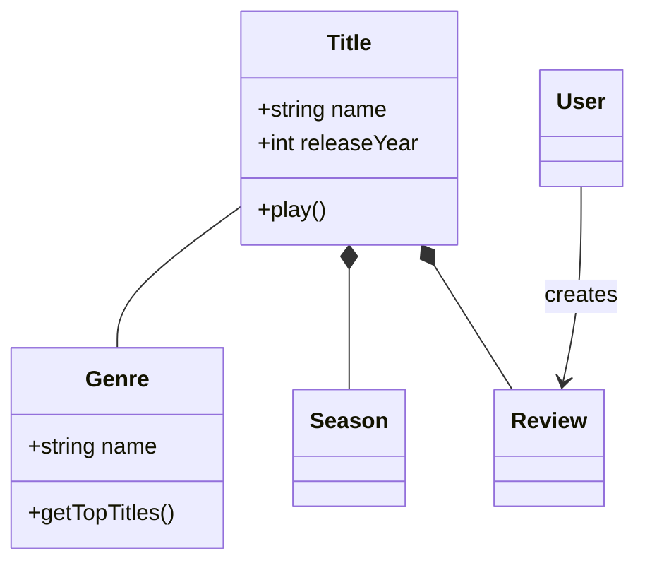
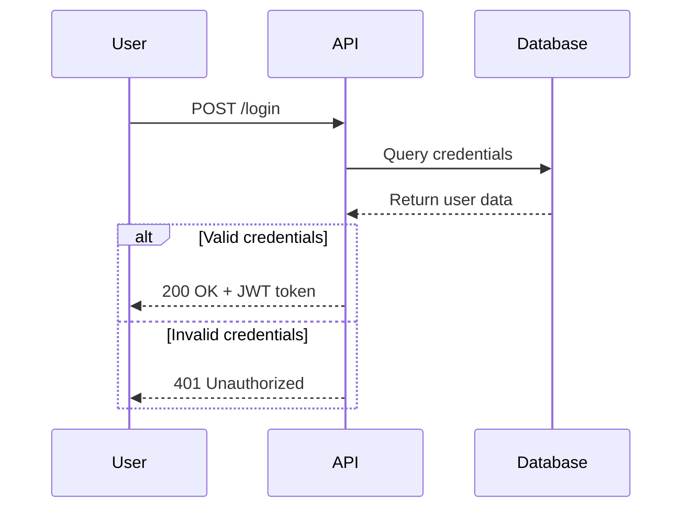
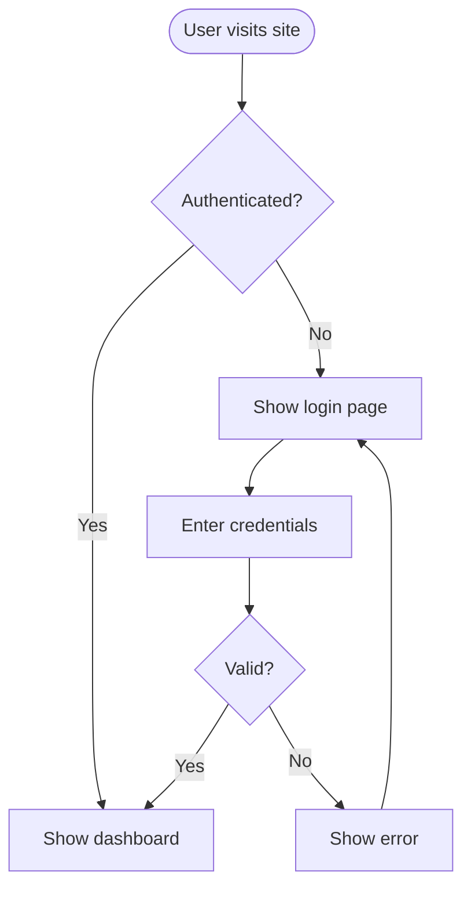
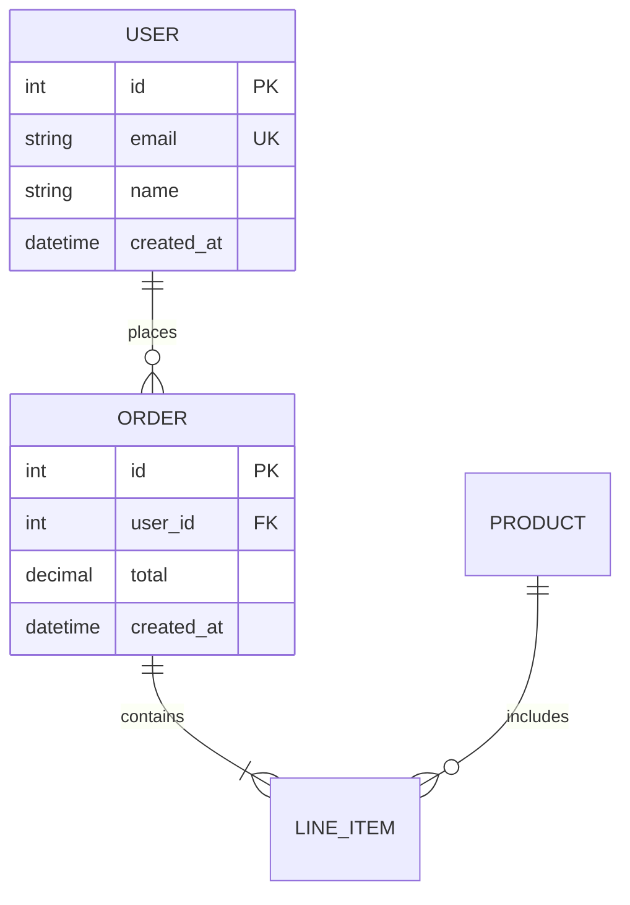
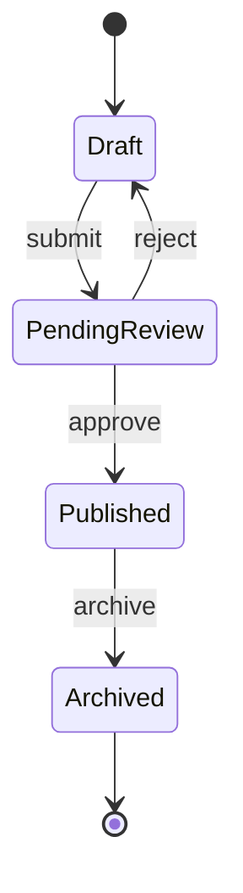
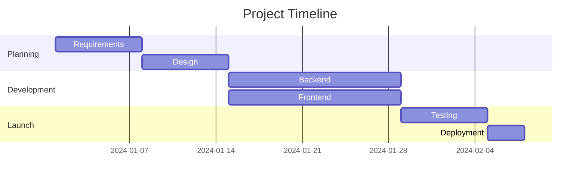
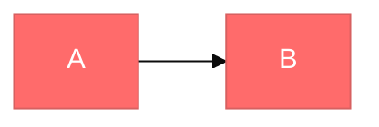

# Mermaid Diagramming

Scope: Comprehensive guide for creating software diagrams using Mermaid syntax. Use when users need to create, visualize, or document software through diagrams including class diagrams, sequence diagrams, flowcharts, entity relationship diagrams (ERD), C4 architecture diagrams, state diagrams, git graphs, gantt charts, or pie charts. Triggers include requests to "diagram", "visualize", "model", "map out", "show the flow", or when explaining system architecture, database design, code structure, or user/application flows. Do NOT use for general image creation or UI mockups.

Create professional software diagrams using Mermaid's text-based syntax. Mermaid renders diagrams from simple text definitions, making them version-controllable, easy to update, and maintainable alongside code.

---

## Diagram Type Selection Guide

Choose the right diagram type for the task:

| Type | Best For |
|------|----------|
| **Class Diagrams** | Domain modeling, OOP design, entity relationships |
| **Sequence Diagrams** | API flows, authentication, component interactions |
| **Flowcharts** | Processes, algorithms, user journeys, business logic |
| **ERD** | Database schemas, data modeling |
| **C4 Diagrams** | System context, containers, components, architecture levels |
| **State Diagrams** | State machines, lifecycle states |
| **Git Graphs** | Version control branching strategies |
| **Gantt Charts** | Project timelines and scheduling |
| **Pie/Bar Charts** | Data distribution and comparison |

---

## Core Syntax

All Mermaid diagrams follow this pattern:

```mermaid
diagramType
  definition content
```

**Key principles:**
- First line declares the diagram type
- Use `%%` for comments
- Line breaks and indentation improve readability but aren't required
- Unknown words or misspellings break diagrams silently — validate in [Mermaid Live Editor](https://mermaid.live)

---

## Steps

1. Choose the diagram type from the Diagram Type Selection Guide above.
   Verify that the type matches the question being answered (for example `sequenceDiagram` for an API flow).
2. Write the definition to `diagram.mmd`, starting with the type declaration and a `title:` line.
   Verify with `head -n 3 diagram.mmd` that the first lines declare the diagram type.
3. Render it with `npx -y @mermaid-js/mermaid-cli -i diagram.mmd -o diagram.svg` (or `mmdc -i diagram.mmd -o diagram.svg`).
   Verify that the command exits 0 and `ls -l diagram.svg` shows a non-empty file.
4. Embed the same definition in the Markdown document inside a `mermaid` fenced block.
   Verify with `grep -c '```mermaid' <doc>.md` that the block is present.

## Failure recovery

| Failure | Cause | Recovery |
| --- | --- | --- |
| `mmdc` reports a parse error | A misspelled keyword, or `{}` in a comment or label | Fix the line named in the error, escape or remove the special characters, and re-render |
| Diagram type is not drawn | The target renderer lacks C4 or newer config features | Redraw the same relationships as a `flowchart` and keep the architecture labels |
| `mmdc` cannot launch a browser | Headless Chromium is missing in the environment | Use the Docker image `minlag/mermaid-cli` shown under Exporting and Rendering |
| Diagram is unreadable | Too many nodes in one view | Split it into several focused diagrams, one per concept |

## Quick Start Examples

### Class Diagram (Domain Model)



### Sequence Diagram (API Flow)



### Flowchart (User Journey)



### ERD (Database Schema)



### State Diagram



### Gantt Chart



---

## Configuration and Theming

Configure diagrams using frontmatter:



**Available themes:** `default`, `forest`, `dark`, `neutral`, `base`

**Look options:**
- `look: classic` — Traditional Mermaid style
- `look: handDrawn` — Sketch-like appearance

---

## Best Practices

1. **Start Simple** — Begin with core entities, add details incrementally
2. **Use Meaningful Names** — Clear labels make diagrams self-documenting
3. **Keep Focused** — One diagram per concept; split large diagrams into multiple focused views
4. **Add Context** — Include titles (`title: <text>`) and notes to explain purpose
5. **Version Control** — Store `.mmd` files alongside code for easy updates
6. **Validate First** — Use [Mermaid Live Editor](https://mermaid.live) to confirm syntax before finalizing
7. **Comment Extensively** — Use `%%` to explain complex relationships

---

## Common Pitfalls

- **Breaking characters** — Avoid `{}` in comments; use escape sequences for special characters in labels
- **Syntax errors** — Misspellings break diagrams; validate in Mermaid Live
- **Overcomplexity** — Split complex diagrams into multiple focused views
- **Missing relationships** — Document all important connections between entities

Renderer support varies, especially for C4 and newer configuration features. If a
requested diagram type is unavailable in the target renderer, express the same
relationships with a portable flowchart and retain the architecture-level labels.

---

## Exporting and Rendering

**Native support in:**
- GitHub/GitLab — Automatically renders in Markdown
- VS Code — With Markdown Mermaid extension
- Notion, Obsidian, Confluence — Built-in support

**Export options:**
- [Mermaid Live Editor](https://mermaid.live) — Online editor with PNG/SVG export
- Mermaid CLI: `npm install -g @mermaid-js/mermaid-cli` then `mmdc -i input.mmd -o output.png`
- Docker: `docker run --rm -v $(pwd):/data minlag/mermaid-cli -i /data/input.mmd -o /data/output.png`
