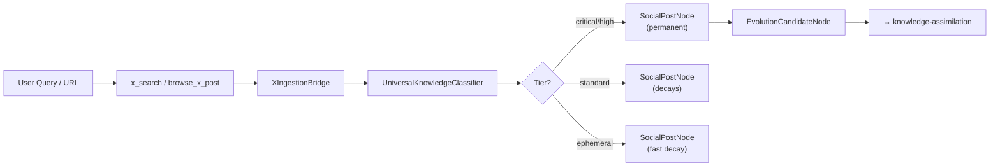

# X Posts to KG Ingestion Workflow

Scope: Search X (formerly Twitter) posts and ingest content into the Knowledge Graph with automatic classification, tiered memory, and self-evolution awareness. Uses the xAI Responses API (grok-4.3) for search, the UniversalKnowledgeClassifier for scoring, and XIngestionBridge for structured KG persistence. Supports tweets, threads, and X Articles (long-form content). Triggers on "search X", "ingest X posts", "browse X", "x to kg", "x research", "social media ingestion".

Searches X posts for a given query and ingests the content, author metadata,
engagement statistics, and extracted concepts directly into the Knowledge Graph.
Uses the `UniversalKnowledgeClassifier` for importance scoring and
`XIngestionBridge` for structured persistence.

## Architecture



## Steps

1. Search X for the topic with `x_search`, or open a single post with `browse_x_post` and `auto_ingest=true`. Verify that the result lists posts with content, engagement metrics and classification results.
2. For results that were not auto-ingested, create each node with `mcp_arbora_graph_write` using `action: "add_node"` and `node_type: "SocialPost"`. Verify that the response returns the node id `social:x:<post_id>`.
3. Create the author with `mcp_arbora_graph_write` (`node_type: "Person"`) and link it with `action: "add_edge"` and `rel_type: "CREATED_BY_PERSON"`. Verify that the edge is returned for each post.
4. For X Articles (content over 3000 characters or an `x.com/*/articles/*` URL), fetch with `read_url_content` and ingest with `mcp_arbora_graph_ingest`. Verify that an `Article` node exists and a `PROMOTES_RESEARCH` edge points to it from the SocialPost.
5. Check the classification tier of what was stored against the Classification Tiers table. Verify that critical and high posts are permanent and that candidates with evolution potential of 0.6 or more have an `EvolutionCandidateNode`.

## Failure recovery

| Failure | Cause | Recovery |
|---------|-------|----------|
| `x_search` returns nothing | The xAI credentials are missing or the query is too narrow | Check the xAI API key configured for the agent and broaden the query terms, then search again. |
| Duplicate SocialPost nodes | A post was ingested by `auto_ingest` and again by hand | Use the stable id `social:x:<post_id>` so a rewrite updates the same node, and skip posts that were auto-ingested. |
| Article content truncated | The post was ingested as a tweet instead of an article | Fetch the article URL with `read_url_content` and ingest it with `mcp_arbora_graph_ingest` `action: "ingest"`. |
| `graph_write` calls fail | The arbora connection is down | Check the arbora MCP connection, reconnect, and rerun the failing write. |

## Execution Steps

### Step 0: x-search-agent
Search X using `x_search` for a topic query, or browse a specific post URL
using `browse_x_post` with `auto_ingest=True`.

**For topic search:**
```
Use x_search with query: "{{task}}"
```

**For specific post:**
```
Use browse_x_post with url: "{{task}}", auto_ingest: true
```

When `auto_ingest=True`, the browse tool automatically:
1. Retrieves the post via xAI Responses API (grok-4.3)
2. Classifies content via UniversalKnowledgeClassifier
3. Creates SocialPostNode + Person + KBConcept nodes
4. Creates EvolutionCandidateNode if evolution potential ≥ 0.6

Expected: posts with content, engagement metrics, classification results

### Step 1: arbora
For search results (not auto-ingested), manually ingest each result into the KG
using the XIngestionBridge pattern.

For each result from Step 0:

1. Create SocialPost node:
```
Use mcp_arbora_graph_write with action: "add_node",
node_type: "SocialPost",
node_id: "social:x:<post_id>",
properties: '{
  "post_id": "<id>",
  "author_handle": "<handle>",
  "content_text": "<text>",
  "post_url": "<url>",
  "post_type": "tweet|article|thread",
  "importance_score": <classifier_score>,
  "is_permanent": <true|false>,
  "evolution_potential": <score>
}'
```

2. Create Person node and link:
```
Use mcp_arbora_graph_write with action: "add_node",
node_type: "Person", node_id: "person:x:<handle>"

Use mcp_arbora_graph_write with action: "add_edge",
source_id: "social:x:<id>", target_id: "person:x:<handle>",
rel_type: "CREATED_BY_PERSON"
```

3. For each extracted concept, create KBConcept + ABOUT edge

4. For X Articles (long-form content), fetch full article:
```
Use read_url_content with url: "<article_url>"
```
Then ingest via:
```
Use mcp_arbora_graph_ingest with action: "ingest", target_path: "<url>"
```
Link SocialPost → Article via PROMOTES_RESEARCH edge.

Expected: cypher, ingest, concepts linked
Depends On: Step 0

## X Article Detection

X Articles are long-form posts (up to ~100K chars) that the xAI API returns
as tweets but contain article links. The bridge detects these by:

1. Content length > 3000 characters
2. URL patterns matching `x.com/*/articles/*`

When detected, the article is fetched via browser/read_url_content and
ingested through the full KBIngestionEngine pipeline, producing:
- `Article` node with summary, content, word count
- `KBConcept` nodes for extracted concepts
- `KBFact` nodes for atomic facts
- `PROMOTES_RESEARCH` edge from the originating SocialPost

## Classification Tiers

| Tier | Importance | Permanent | Decay | Evolution |
|------|-----------|-----------|-------|-----------|
| Critical | ≥ 0.9 | ✅ | None | Auto-trigger |
| High Value | 0.7–0.9 | ✅ | None | Flagged |
| Standard | 0.4–0.7 | ❌ | 5%/day | No |
| Ephemeral | ≤ 0.3 | ❌ | 10%/day | No |

## References

- `knowledge-assimilation` — Full evolution pipeline
- The package-specific X architecture guide is owned by `meristem` at
  `docs/guides/x-assistant.md`; it is not bundled with this workflow.

## Execution

Run this workflow as a dependency-ordered DAG. Steps with no unmet `depends_on` run in parallel; dependents run after their prerequisites complete.

- **Run first (in parallel):** Step 0 — x-search-agent; Step 1 — arbora

**Execution:** If arbora is reachable, offload the whole DAG via `graph_orchestrate action=execute_workflow` (or the `kg-delegate` skill) for true parallel/swarm execution. Otherwise execute the steps natively in dependency order: run steps with no unmet `depends_on` in parallel, then their dependents.
